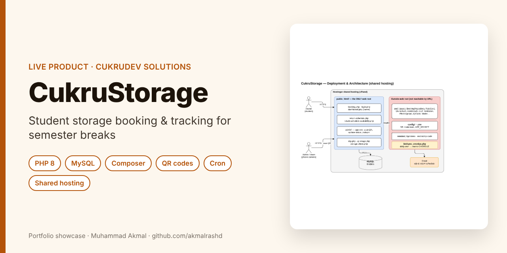
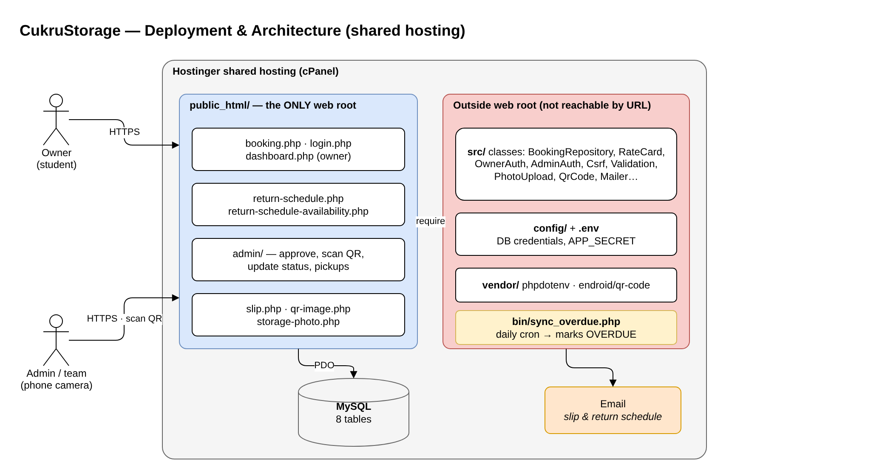
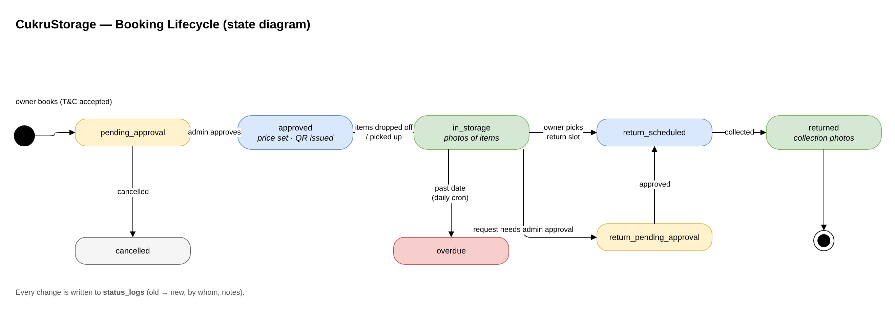
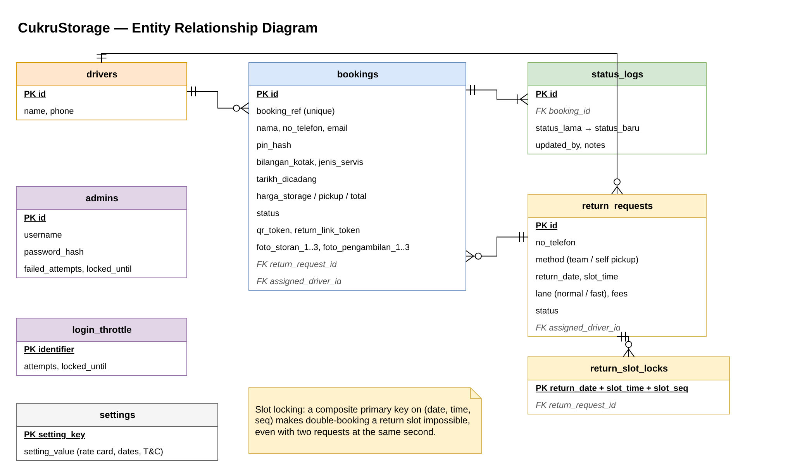

# CukruStorage: Student Storage Booking System

> **Portfolio showcase.** CukruStorage is a product of CukruDev Solutions, so the source code is private.

**Company:** CukruDev Solutions · **Role:** Sole developer · **Period:** July – October 2026 (70 commits)

   

---

## The problem

During semester breaks, students need somewhere to keep their boxes. CukruStorage lets students book drop-off or pickup online, and lets the team track every box with a QR code until it is returned.

## Features

| Who | Features |
|---|---|
| **Owner (student)** | Booking form with date-window rules and T&C acceptance, phone + PIN login, dashboard with live status, return-slot booking (team delivery or self pickup, normal or fast lane) |
| **Admin / team** | Approve bookings (price auto-calculated from the rate card, can override), printable slip with QR, scan QR with a phone camera to open a booking, status updates with photos, assign team members to pickups |
| **System** | Daily cron marks overdue bookings, email for slips and return schedules, full status history |

## System design

Editable draw.io sources are in [`docs/diagrams`](docs/diagrams).

### Deployment and architecture

### Booking lifecycle (state diagram)

### Entity relationship diagram

## Engineering highlights

- **Only `public_html/` is web-accessible.** Classes, config and `.env` live outside the web root, so credentials and logic cannot be fetched by URL, even on cheap shared hosting.
- **Security basics done properly:** hashed PINs and passwords, CSRF tokens, login throttling with lockout, secure session cookies over HTTPS.
- **No double-booked return slots:** a composite primary key on (date, time, sequence) makes a clash impossible at the database level.
- **Audit trail:** every status change is written to `status_logs` with who changed it and why.
- Plain PHP with a small repository layer, no framework, built to fit cPanel hosting without SSH.

## How I used AI tools

I used AI coding assistants (mainly Claude Code) for boilerplate, refactoring suggestions and debugging. The requirements, data model and business rules come from running the service with the CukruDev team, and I tested each flow before release.

## Contact

**Muhammad Akmal bin Mohd Rashid**: Software Engineering student, UMPSA.  
Open to a 6-month internship (22 February to 7 August 2027).  
📧 work.akmalrashd@gmail.com · 💼 [linkedin.com/in/akmalrashd](https://www.linkedin.com/in/akmalrashd)
